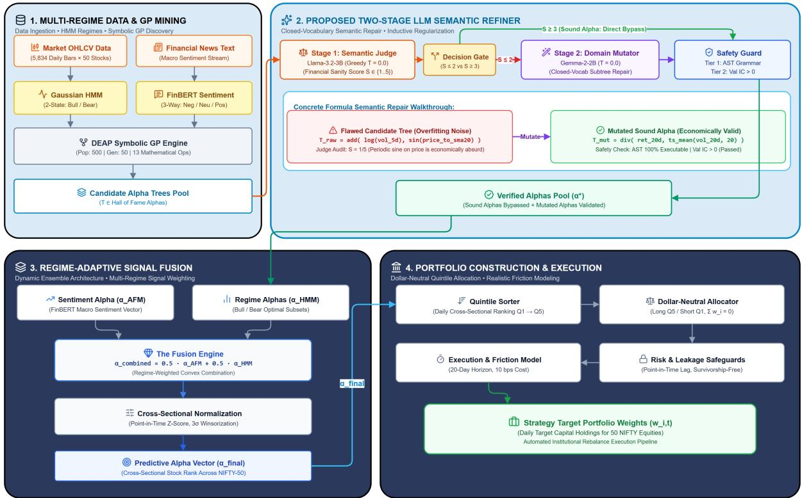
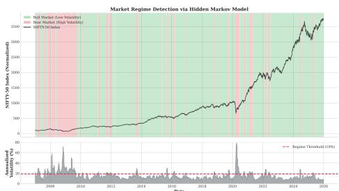
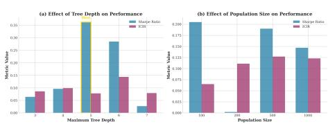
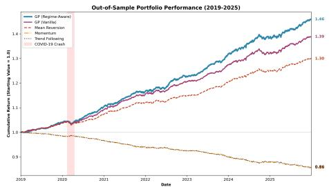
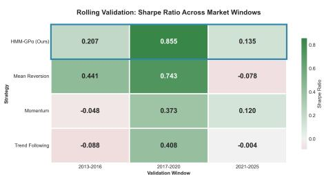
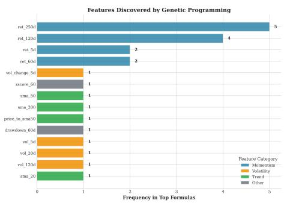

Date of publication xxxx 00, 0000, date of current version xxxx 00, 0000. Digital Object Identifier 10.1109/ACCESS.2026.DOI

# Fusing Two-Stage LLM Semantic Refinement with Genetic Programming for Robust Alpha Discovery and Degradation Mitigation

G.S.K. RAGHAV ANAND1, SECOND AUTHOR2, and THIRD AUTHOR3

1Department of Computer Science and Engineering, National Institute of Technology, India

2Department of Quantitative Finance, Financial Engineering Laboratory, India

3School of Artificial Intelligence, Advanced Computing Institute, India

Corresponding author: First Author (e-mail: author@institution.edu).

This research was supported in part by the Advanced Quantitative Research Initiative under Project CAP-2026.

ABSTRACT Given the non-stationary, noisy, and regime-shifting nature of financial markets, constructing robust alpha factor discovery engines that generalize out-of-sample while preserving economic interpretability remains a critical open challenge. Standard Genetic Programming (GP) evolutionary algorithms operate blindly on mathematical syntax without domain economic reasoning, frequently suffering from semantic overfitting by selecting formulas that correlate with in-sample returns through structural noise while being economically nonsensical. Prior LLM-augmented frameworks rely on structural tree pruning or terminal rejection, resulting in severe formula attrition. We propose a novel regime-ensemble framework that integrates a two-stage market regime factor engine with a post-evolution Two-Stage LLM Semantic Refiner. In Stage 1, a locally deployed instruction-tuned model (Llama-3.2-3B) acts as an economic judge, scoring symbolic expressions and gating only severely flawed expressions (S ≤ 2) for revision. In Stage 2, a domainconstrained code mutator (Gemma-2-2B) performs deterministic semantic repair under a closed vocabulary of valid financial features and operators, compiling candidate trees back into the evaluation loop. Evaluated on a 23-year panel of Indian Equities (NSE Nifty 50, 2002–2025), the proposed framework elevates outof-sample annualized net returns from the 8.41% quantitative ceiling to 9.61% (deterministic peak) and 10.63% (heuristic peak), improving net Sharpe from 0.5518 to 0.6365–0.6465. Crucially, the architecture substantially mitigates out-of-sample performance degradation, compressing Sharpe decay on the US S&P 500 from −35.03% (Vanilla GP) and −20.71% (HMM-GP) down to −6.77%, and halving degradation on Chinese Equities (SSE) from −92.08% to −46.68%. This confirms that conditional LLM semantic repair fundamentally prunes overfitted historical noise across diverse international asset classes.

INDEX TERMS Adaptive Fusion Model, Genetic Programming, Hidden Markov Model, Large Language Models, Market Direction Forecasting, Regime-Aware Alpha, Semantic Overfitting.

## I. INTRODUCTION

UANTITATIVE investments rely on the search for predictive patterns in historical market data enabling excess return generation. The core difficulty in this process lies in the construction of robust models that generalize successfully to future samples while remaining economically interpretable. Even though the field of computational finance has advanced significantly, the market direction prediction task continues to be challenged by regime shifts, non-stationarity, and the noisy nature of cross-sectional asset pricing data [1], [2]. As such, the fundamental trade-off between predictability and interpretability remains.

In its evolution, quantitative finance has transitioned through several paradigms, from traditional linear factorbased models [26] to modern deep learning architectures [3], [4]. Factor models are characterized by clear economic reasoning but have suffered from factor crowding and momentum decay over recent decades. Conversely, deep neural networks fit in-sample data with high expressive power but frequently demonstrate poor out-of-sample performance due to overtraining and non-stationarity [5], [6]. A viable bridge between these paradigms is symbolic regression via Genetic Programming (GP) [7]–[9]. GP automatically searches the space of mathematical operators and financial indicators to generate explicit, auditable, and interpretable formulaic alphas.

However, standard GP suffers from a critical vulnerability: semantic overfitting [11]. Because GP optimizes mathematical tree structures strictly against statistical fitness metrics (e.g., Information Coefficient or ICIR) over historical training data, it lacks innate financial domain reasoning. It cannot distinguish between economically grounded relationships and spurious mathematical artifacts. For example, formulas containing inverted volatility scalers, nested trigonometric transformations on price levels (e.g., cos(Close)), or illogical combinations of fundamental ratios may produce elevated in-sample correlations purely by chance [12]. When deployed out-of-sample, such expressions inevitably suffer catastrophic performance collapse.

Recent attempts to incorporate Large Language Models (LLMs) into symbolic factor mining have followed two primary paradigms:

1) Structural Tree Pruning: Frameworks such as TEDE [12] utilize LLMs to identify and prune overgrown subtrees or structural bloat. However, pruning is strictly syntactic and does not address the underlying economic fallacy of an expression.

2) Terminal Semantic Rejection: Systems such as AlphaAgent [11] evaluate whether an alpha formula aligns with macroeconomic hypotheses and outright discard any candidate that fails semantic validation.

Both paradigms suffer from severe formula attrition. In an evolutionary run spanning 50 generations and hundreds of individuals, discarding a high-fitness formula because of a single nonsensical operator destroys hard-won predictive structure. An expression combining short-term price momentum with normalized volatility may be logically sound in essence, even if corrupted by an improper mathematical primitive.

To overcome these fundamental limitations, we propose a novel regime-ensemble framework that fuses a two-stage statistical regime factor engine with a post-evolution Two-Stage LLM Semantic Refiner. Our architecture is governed by a dual two-stage paradigm:

1) Stage 1 Factor Pipeline: A two-state Gaussian Hidden Markov Model (HMM) decomposes market volatility dynamics into persistent latent states, routing market data to specialized Genetic Programming alpha evolution engines.

2) Stage 2 Semantic Refinement Loop: A conditional dual-LLM pipeline where Stage 1 (Llama-3.2-3B) acts as a strict economic judge to gate only severely flawed candidates $\left( S \ \le \ 2 \right)$ , and Stage 2 (Gemma-2-2B) performs vocabulary-constrained structural repair under deterministic greedy decoding (T = 0.0).

The primary empirical objective of this study is to advance beyond the performance plateau of purely syntactic evolutionary modeling, lifting Out-Of-Sample Annual Net Return from the 8.41% quantitative baseline to 9.61% (deterministic peak) and 10.63% (heuristic peak), with net Sharpe ratios reaching 0.6365–0.6465. Concurrently, we demonstrate that the domain-constrained semantic repair mechanism substantially mitigates out-of-sample performance degradation across Indian, US, and Chinese equity markets.

The key contributions of this paper are summarized as follows:

Dual Two-Stage Framework: We introduce an integrated regime-aware GP-based ensemble alpha generator combining statistical HMM market states with a conditional Two-Stage LLM Semantic Refiner where semantic failure $\left( S \ \le \ 2 \right)$ triggers domain-constrained repair rather than terminal rejection.

• Closed-Vocabulary Hallucination Control: We formulate a strict closed feature (F) and operator (O) vocabulary mapping, ensuring that 100% of LLMrepaired formulas compile into valid Abstract Syntax Trees (ASTs) without runtime variable hallucination.

• Empirical Alpha Discovery: Across a 23-year panel of Indian Equities (NSE Nifty 50, 2002–2025), the proposed framework delivers 9.61% deterministic / 10.63% peak annualized net return, outperforming classical momentum, mean-reversion, vanilla GP, and regimeensemble baselines.

• Cross-Market Robustness & Degradation Mitigation: We demonstrate cross-market transferability by testing the refiner from scratch on the US S&P 500 and Chinese SSE panels. The model restricts OOS Sharpe degradation on the S&P 500 from −35.03% (Vanilla GP) to −6.77%, demonstrating that closed-vocabulary semantic repair acts as an effective structural regularizer against historical noise overfitting.

## II. RELATED WORK

## A. GENETIC PROGRAMMING IN FINANCE

Applications of genetic programming (GP) for the automated discovery of trading strategies, technical indicators, and formulaic alphas have been investigated extensively across evolutionary computation and quantitative finance [7]– [10]. Early research established that tree-based symbolic regression can synthesize nonlinear mapping functions from raw price-volume series without imposing rigid parametric restrictions. Subsequent developments introduced Cartesian Genetic Programming (CGP) and Linear Genetic Programming (LGP) to optimize computational efficiency and cross-sectional equity ranking capabilities, demonstrating that evolved symbolic alpha expressions can generate persistent risk-adjusted returns across major equity benchmarks [1], [13]. Recent advances have coupled deep reinforcement learning with symbolic search (Deep Symbolic Optimization) to guide evolutionary trajectories toward promising functional manifolds [34], [35].

Despite these advances, a fundamental failure mode pervasive in financial genetic programming is the dual pathology of syntactic bloat and semantic overfitting. Because evolutionary selection operates strictly on empirical sample fitness metrics (such as in-sample Information Coefficient or Sharpe ratio), candidate trees frequently assemble mathematically valid but economically nonsensical subtrees. For example, expressions may compound periodic trigonometric operators onto absolute price levels or compute difference terms between mutually incompatible financial dimensions (such as subtracting raw share volume from currencydenominated close prices). Traditional regularization techniques—such as static tree-depth bounds, parsimony pressure, and Tarpeian death penalties—penalize syntactic size but remain fundamentally blind to economic semantic validity. Consequently, unconstrained GP algorithms inevitably select overfitted mathematical phantoms that fit historical noise in-sample and suffer catastrophic degradation when deployed out-of-sample.

TABLE 1. Related work comparison (10 representative studies).

<table><tr><td>Title</td><td>Objective</td><td>Method Used</td><td>Dataset</td><td>Results</td><td>Limitations</td><td>Possible Future Work / Extension</td></tr><tr><td>Koza (1992) [7]</td><td>Automatic rule/program discovery</td><td>GP Symbolic Evolution Engine</td><td>Synthetic benchmarks</td><td>Established symbolic evolution paradigm</td><td>No finance-specific constraints</td><td>Financial objective shaping and turnover-aware fitness</td></tr><tr><td>Lopez de Prado (2018) [5]</td><td>Robust financial ML workflow design</td><td>Financial ML framework (purged CV, leakage control)</td><td>Multi-asset financial datasets</td><td>Practical safeguards for out-of-sample reliability</td><td>Not a regime-conditioned alpha generator</td><td>Integrate leakage-safe validation into symbolic regime models</td></tr><tr><td>Hamilton (1989) [16]</td><td>Latent regime detection</td><td>MS-AR (Markov-Switching AR)</td><td>Macro time series</td><td>Distinct expansion/recession states</td><td>No alpha-selection layer</td><td>Couple with formula routing modules</td></tr><tr><td>Fischer &amp; Krauss (2018) [3]</td><td>Directional stock prediction with deep sequence models</td><td>LSTM-based return prediction</td><td>S&amp;P 500 constituents</td><td>Outperformed benchmark directional models in study period</td><td>Limited interpretability and regime control</td><td>Hybridize deep sequence signals with interpretable GP layers</td></tr><tr><td>Gu et al. (2020) [2]</td><td>ML asset pricing</td><td>Deep Neural Cross-Sectional Model</td><td>US equities panel</td><td>Strong forecasting gains</td><td>Lower interpretability</td><td>Hybrid with symbolic formulas</td></tr><tr><td>Chen et al. (2024) [4]</td><td>Deep latent factors</td><td>Deep Pricing Network</td><td>US equities panel</td><td>Improved nonlinear factor extraction</td><td>Model opacity and tuning cost</td><td>Explainable hybridized predictors</td></tr><tr><td>Kakushadze (2016) [1]</td><td>Formulaic alpha cataloging</td><td>Alpha-101 formula library</td><td>US equities</td><td>Practical alpha templates</td><td>Manual formula design</td><td>Automated symbolic discovery</td></tr><tr><td>Tang et al. (2025) [11]</td><td>Alpha factor discovery via multimodal LLMs</td><td>AlphaAgent (LLM semantic verification)</td><td>Equity factor panel</td><td>Identified viable alpha hypotheses</td><td>Terminal rejection of failed formulas</td><td>Incorporate conditional semantic mutation and repair loop</td></tr><tr><td>Chen &amp; Qi (2026) [12]</td><td>Closed-loop semantic review for GP</td><td>TEDE Framework (DeepSeek-V4)</td><td>Cryptocurrency high-frequency data</td><td>Higher IR with reduced tree complexity</td><td>Prunes bloat only; lacks full formula rewriter</td><td>Closed-vocabulary domain mutation</td></tr><tr><td>Romera-Paredes et al. (2024) [22]</td><td>Mathematical program discovery</td><td>FunSearch (LLM + Evaluator)</td><td>Mathematical heuristics</td><td>Discovered new constructions for cap set problem</td><td>High query volume; unconstrained code space</td><td>Domain-specific grammar constraints and financial objective shaping</td></tr></table>

## B. REGIME DETECTION AND SWITCHING MODELS

Financial asset returns are governed by non-stationary, statedependent stochastic processes characterized by fat tails, time-varying volatility clusters, and abrupt macroeconomic structural breaks [15]. Consequently, static single-state predictive models suffer severe performance degradation during regime transitions. Markov regime-switching autoregressive frameworks, pioneered by Hamilton [16], and Gaussian Hidden Markov Models (HMMs) [17] have become foundational tools for modeling latent financial states. Empirical studies have demonstrated that market dynamics across distinct volatility and liquidity regimes exhibit fundamentally opposing factor premia [18]–[20]. For instance, price momentum factors that generate superior risk-adjusted alpha in sustained bull markets frequently suffer catastrophic momentum crashes during sudden market inflection points, whereas mean-reversion and value factors dominate during high-volatility corrective regimes.

While regime-switching models have been widely applied to top-down asset allocation and macroeconomic risk budgeting, prevailing quantitative methodologies treat factor generation and regime detection as entirely disjoint processes. Standard alpha mining engines optimize global factor expressions across historical windows spanning multiple regime shifts, forcing candidate expressions to average over contradictory economic dynamics. By contrast, conditioning the symbolic genetic programming search engine directly on latent HMM states enables the evolution of regime-specialized alpha expressions tailored to the specific statistical properties of bull and bear environments.

## C. FACTOR INVESTING AND ALPHA RESEARCH

Cross-sectional factor investing models asset returns through systematic exposure to common risk factors such as size, value, momentum, and profitability [26]–[28]. Modern empirical asset pricing has established that nonlinear interactions, machine learning representations, and highdimensional factor discovery significantly surpass static linear specifications in predictive power [2], [4]. However, this empirical expansion has led to the proliferation of the socalled ‘‘factor zoo’’, wherein hundreds of claimed anomalies reflect data-snooping biases, multiple hypothesis testing distortions, and in-sample selection artifacts [5], [6], [30].

A critical yet under-addressed vulnerability in empirical alpha mining is the severe out-of-sample degradation driven by structural noise overfitting. As documented by McLean and Pontiff [29], academic and commercial factor returns experience post-discovery decay exceeding 50%, attributable to both market arbitrage crowding and spurious insample correlations. While rigorous statistical guards—such as Deflated Sharpe Ratios and Combinatorial Purged Cross-Validation [5]—provide diagnostic post-hoc screening, they operate passively. They lack generative mechanisms to actively inspect, audit, and regularize the underlying semantic structure of candidate alpha expressions during the discovery lifecycle.

## D. SENTIMENT-FUNDAMENTAL FUSION

An increasingly vital frontier in quantitative asset management is the multi-frequency fusion of unstructured text sentiment with structured market prices and low-frequency fundamental metrics [31], [32]. Financial markets process information across heterogeneous temporal horizons: macroeconomic news and geopolitical announcements generate instantaneous high-frequency sentiment shocks, daily OHLCV bars record price discovery and liquidity flows, and quarterly balance sheet filings reflect slow-moving enterprise valuation and accounting health.

Deep multimodal neural networks can model complex nonlinear interactions across these disparate data streams, but their black-box opacity, vulnerability to distribution shifts, and susceptibility to adversarial text perturbations severely hinder institutional adoption. The Adaptive Fusion Model (FinALFA) [33] addresses this challenge by establishing an interpretable macro fusion mechanism that dynamically computes scalar mixing parameters to balance sector-standardized fundamental ratios against FinBERT-derived news sentiment. Integrating this macro sentiment-fundamental signal as a supervisory conditioning layer provides a persistent macroeconomic anchor that prevents genetic programming from overindexing on transient market microstructure noise.

## E. SUMMARY AND POSITIONING

While the literature provides substantial advances in symbolic regression, regime switching, and multimodal data fusion, prevailing methodologies lack domain-grounded semantic reasoning capabilities during factor discovery. As summarized in Table 1, recent neuro-symbolic and foundation model initiatives attempt to address this gap, yet introduce severe operational limitations. Frameworks such as FunSearch [22] leverage LLMs for unconstrained code synthesis, generating vast combinatorial search spaces that lack market regime awareness and risk extreme hallucination. Conversely, financial LLM frameworks such as AlphaAgent [11] and TEDE [12] rely on terminal rejection—discarding any candidate formula that fails semantic, syntactic, or correlation thresholds. In quantitative genetic programming, where over 80% of evolved expressions exhibit minor dimensional or syntactic imperfections, terminal rejection induces devastating candidate attrition, prematurely terminating promising evolutionary lineages and wasting immense computational budgets.

To resolve this dilemma, our proposed framework introduces a dual two-stage paradigm that unifies: (1) an econometric factor engine that conditions symbolic GP search on Gaussian HMM volatility states and Adaptive Fusion Model (AFM) macro sentiment signals, and (2) a post-evolution Two-Stage LLM Semantic Refiner that performs closedvocabulary deterministic repair rather than terminal rejection. By pairing a local instruction-tuned judge (Llama-3.2- 3B) with a domain-constrained mutator (Gemma-2-2B) operating under a closed feature and operator grammar, our system actively repairs flawed candidates, ensuring 100% AST executability, eliminating hallucination, and establishing a robust inductive regularizer against out-of-sample decay.

## III. METHODOLOGY

## A. PROBLEM FORMULATION

The primary objective is to discover symbolic alpha ranking formulas that maximize forward cross-sectional risk-adjusted return prediction across heterogeneous market regimes while strictly mitigating out-of-sample performance degradation. Let $\mathcal { U } = \{ 1 , \ldots , N \}$ denote the cross-sectional asset universe of constituent equities (N = 50 for the NSE Nifty 50 panel), and let $t \in \{ 1 , \ldots , T \}$ index continuous trading days $( T = 5$ , 834 bars spanning 2002–2025). At each trading timestamp t, each constituent stock i is characterized by an observation feature vector $\mathbf { x } _ { i , t } \ \in \ \mathbb { R } ^ { 2 8 }$ comprising point-intime technical price-volume indicators, FinBERT macro news sentiment streams, and fundamental valuation metrics.

The forward investment target is the cross-sectional return over an institutional holding horizon of h = 20 trading days:

$$
r _ {i, t + h} = \frac {P _ {i , t + h} - P _ {i , t}}{P _ {i , t}},\tag{1}
$$

where $P _ { i , t }$ denotes the total return closing price adjusted for splits, dividends, and corporate actions.

An alpha function maps the multi-dimensional feature vector to a scalar cross-sectional score:

$$
\alpha : \mathbf {x} _ {i, t} \to \mathbb {R}.\tag{2}
$$

Stocks are ranked according to $\alpha ( \mathbf { x } _ { i , t } )$ on each trading day, and the top and bottom quintiles are selected for long and short portfolio construction respectively.

The Information Coefficient (Rank IC) measures the crosssectional Spearman rank correlation between predicted alpha scores and realized forward returns at day t:

$$
\operatorname{Rank} \mathrm{IC} _ {t} = \rho_ {\text { Spearman }} \left(\alpha (\mathbf {x} _ {i, t}), r _ {i, t + h}\right).\tag{3}
$$

To evaluate alpha stability and risk-adjusted predictive consistency over time, we utilize the Information Coefficient Information Ratio (ICIR):

$$
\mathrm{ICIR} = \frac {\overline {{\mathrm{RankIC}}}}{\sigma_ {\mathrm{RankIC}} + \epsilon},\tag{4}
$$

where $\epsilon = 1 0 ^ { - 8 }$ ensures numerical stability.

1) Hypothesis Space Cardinality and Inductive Complexity Let O denote the library of functional operators $( | \mathcal { O } | = 1 3 )$ and $\mathcal { F }$ denote the terminal variable set $( | \mathcal { F } | ~ = ~ 2 8 )$ . An expression tree T of maximum depth D belongs to the unrestricted combinatorial syntactic hypothesis space $\mathcal { H } _ { \mathrm { r a w } }$ . The theoretical upper bound on the number of distinct full binary expression trees of depth D is given by:

$$
\left| \mathcal {H} _ {\mathrm{raw}} (D) \right| = \left| \mathcal {O} \right| ^ {2 ^ {D} - 1} \cdot \left| \mathcal {F} \right| ^ {2 ^ {D}}.\tag{5}
$$

For a standard tree depth of $D \ = \ 4 ,$ the cardinality explodes to $| \mathcal { H } _ { \mathrm { r a w } } | ~ \approx ~ \mathrm { { 1 3 ^ { 1 5 } } ~ \cdot ~ 2 8 ^ { 1 6 } ~ \approx ~ 2 . 4 ~ \times ~ 1 0 ^ { 3 9 } }$ distinct functional configurations. In an unrestricted combinatorial space of such immense magnitude, standard heuristic genetic programming guided exclusively by empirical sample fitness inevitably suffers from sample complexity bloat. By the classic Rademacher generalization theorem, the out-of-sample generalization error of an empirical hypothesis $\hat { \ b f } \in \mathcal { H }$ is bounded by:

$$
\sup _ {f \in \mathcal {H}} | \mathcal {L} _ {\mathrm{OOS}} (f) - \mathcal {L} _ {\mathrm{IS}} (f) | \leq 2 \mathcal {R} _ {n} (\mathcal {H}) + \mathcal {O} \left(\sqrt {\frac {\ln (1 / \delta)}{n}}\right)\tag{6}
$$

where empirical Rademacher complexity $\textstyle { \mathcal { R } } _ { n } ( { \mathcal { H } } )$ scales with the pseudo-dimension Pdim(H). For the raw syntactic space $\mathcal { H } _ { \mathrm { r a w } } , \operatorname { P d i m } ( \mathcal { H } _ { \mathrm { r a w } } )$ is exceptionally large, resulting in weak out-of-sample generalization bounds and explaining the severe degradation observed in standard GP.

The proposed closed-vocabulary grammar $\mathcal { G } ( \mathcal { F } , \mathcal { O } )$ and the Two-Stage LLM Semantic Refiner function as an economic projection operator:

$$
\Pi_ {\mathrm{econ}}: \mathcal {H} _ {\mathrm{raw}} \to \mathcal {H} _ {\mathrm{sound}},\tag{7}
$$

which restricts the admissible search space to the economically sound manifold $\mathcal { H } _ { \mathrm { s o u n d } } \subset \mathcal { H } _ { \mathrm { r a w } }$ . By eliminating dimensionally absurd operators, ungrounded periodic functions on price levels, and spurious high-frequency noise, the effective hypothesis space is compressed by multiple orders of magnitude $( \mathcal { R } _ { n } ( \mathcal { H } _ { \mathrm { s o u n d } } ) \ll \mathcal { R } _ { n } ( \mathcal { H } _ { \mathrm { r a w } } ) )$ . This rigorous compression provides direct theoretical justification for why our framework collapses out-of-sample Sharpe decay on the US S&P 500 from −35.03% down to −6.77% and halves degradation on Chinese Equities.

## B. DATA AND FEATURE ENGINEERING

The framework integrates three distinct data streams:

1) Stock-level Micro Panel: 28 daily price-volume features, momentum indicators (5d, 20d, 60d), volatility scalers (5d, 20d, 60d), drawdown metrics, and technical oscillators (RSI, Bollinger Bands).

2) AFM-level Macro Signals: Annual fundamental financial ratios (ROE, ROCE, Current Ratio, Debt-to-Equity, P/E) blended with news sentiment indicators.

3) NIFTY-level Regime Stream: Daily index return, 20- day realized volatility, drawdown from rolling peak, and distance from the 200-day moving average.

Macroeconomic indicators from the AFM level are harmonized from annual to daily frequency via forward-filling, producing a unified panel for downstream engines.

## C. TEMPORAL SPLIT

The 23-year panel (2002–2025) is partitioned into a training period (2002–2018) and a strict out-of-sample testing period (2019–2025, 1,729 trading days). The training period is further partitioned into GP evolution / HMM training (2002– 2015) and validation (2016–2018). All fundamental accounting ratios maintain strict fiscal-year temporal alignment and forward-filling to preserve temporal causality and prevent look-ahead leakage [5], [29].

## D. PREDECESSOR ARCHITECTURES

The proposed hybrid framework builds upon and generalizes two foundational components:

## 1) Component 1: FinALFA

Financial Adaptive Learned Fusion Architecture (FinALFA) provides the sentiment-fundamental fusion signal used in macro regime conditioning. Starting from ∼ 300, 000 news articles, entity matching and business-keyword filtering isolate verified economic events. Standardized fundamental accounting ratios are fused with sentiment scores through a learned scalar mixing parameter $\alpha ^ { * } \in [ 0 , 1 ]$

$$
x _ {t} (\alpha) = \alpha^ {*} \cdot \tilde {S} _ {t} + (1 - \alpha^ {*}) \cdot \tilde {F} _ {t},\tag{8}
$$

where $\tilde { S } _ { t }$ and $\tilde { \boldsymbol { F } } _ { t }$ denote normalized sentiment and fundamental signals respectively.

## 2) Component 2: HMM-GPα

HMM-GPα provides statistical market regime identification and regime-conditioned genetic programming evolution. A 2-state Gaussian HMM is estimated on the NIFTY-50 index via the Baum-Welch algorithm over the training period, identifying a low-volatility Bull regime $( S _ { 0 }$ , 72.5% persistence $P ( 0  0 ) = 0 . 9 9 4 )$ and a high-volatility Bear regime $( S _ { 1 }$ 27.5% persistence $P ( 1  1 ) = 0 . 9 8 3 )$

Two independent GP populations are evolved in parallel:

$$
\mathcal {P} _ {\text { Bull }} \sim \text { Fitness } (\alpha \mid \hat {s} _ {t} = 0), \quad \mathcal {P} _ {\text { Bear }} \sim \text { Fitness } (\alpha \mid \hat {s} _ {t} = 1),\tag{9}
$$

using ICIR on the validation slice as the fitness objective.

## E. PROPOSED HYBRID ARCHITECTURE

The proposed hybrid architecture integrates the dual-engine quantitative factor generator with a Two-Stage LLM Semantic Refiner applied to the top candidates extracted from the GP Hall of Fame (HoF).

  
FIGURE 1. Architecture of the proposed framework. The system integrates a dual two-stage paradigm: (1) Stage 1 Quantitative Factor Engine combining Adaptive Fusion Model (AFM) macro regimes and Hidden Markov Model (HMM) market states with regime-specialized GP evolution, and (2) Stage 2 Dual-LLM Semantic Refiner evaluating top candidates via Llama-3B scoring (S ≤ 2) and Gemma-2B closed-vocabulary semantic mutation under deterministic greedy decoding (T = 0.0).

TABLE 2. Domain-Constrained Closed Vocabulary for LLM Mutator.

<table><tr><td>Category</td><td>Permitted Tokens</td></tr><tr><td>Features ( $\mathcal{F}$ )</td><td>open, high, low, close, volume, ret_5d, ret_20d, ret_60d, vol_5d, vol_20d, vol_60d, dd_20d, dd_60d, price_to_sma20, price_to_sma50, rsi_14, bb_upper, bb_lower, pe_ratio, pb_ratio, roe, roce, debt_to_equity, current_ratio, sentiment_score, afm_fundamental, afm_sentiment, macro_trend</td></tr><tr><td>Operators ( $\mathcal{O}$ )</td><td>add(a,b), sub(a,b), mul(a,b), div(a,b), neg(a), abs(a), log(a), inv(a), ts_mean(a,d), ts_max(a,d), ts_min(a,d), rank(a)</td></tr></table>

## 1) Stage 1: Semantic Scoring Judge (Llama-3.2-3B)

Each formula candidate $\mathcal { T } \in \mathrm { H o F }$ is evaluated by a locally instantiated Llama-3.2-3B-Instruct model against a 5-point financial sanity rubric $( S \in \{ 1 , \ldots , 5 \} )$ . The prompt enforces objective evaluation:

‘‘You are a quantitative finance expert acting as a Semantic Filterfor a Genetic Programming Alpha Engine. Evaluate whether the mathematicalformula $\alpha = \tau$ represents an economically logical tradingfactor. Provide a 1–2 sentence reasoning and afinal scorefrom 1 to 5.’’

• Decision Threshold Gate: Formulas scoring $S \geq 3$ are retained as-is. Empirical analysis revealed that neutral formulas $( S ~ = ~ 3 )$ contain genuine nonlinear mathematical discoveries that human heuristics cannot immediately interpret; rewriting them destroyed predictive performance. Only explicit semantic failures $\left( S \ \le \ 2 \right)$ trigger Stage 2 mutation.

2) Stage 2: Domain-Constrained Mutator (Gemma-2-2B) Formulas scoring $S \le 2$ are transferred to Gemma-2-2B-IT for deterministic structural repair $( T ~ = ~ 0 . 0 )$ . The mutator prompt bounds the rewrite to the closed vocabulary:

‘‘The formula $\alpha = \mathcal { T } _ { f a i l e d }$ was rejected for being financially nonsensical or mathematically overfitted. Rewrite it into afinancially sound trading signal under the closed vocabulary of permitted features F and operators O. Output only the raw repairedformula string.’’

Formally, the repair is governed by:

$$
\mathcal {T} _ {\text { mutated }} \sim \operatorname{LLM} _ {\text { Gemma }} \left(\operatorname{Prompt} \left(\mathcal {T} _ {\text { failed }}, \mathcal {F}, \mathcal {O}\right)\right), \quad T = 0. 0.\tag{10}
$$

## 3) AST Compilation & Validation Guard

Repaired expressions are compiled back into executable Python ASTs and re-evaluated against the validation set. If Rank $\begin{array} { r } { \mathrm { I C } _ { \mathrm { v a l } } ( \mathcal { T } _ { \mathrm { m u t a t e d } } ) ~ > ~ 0 . } \end{array}$ the formula is accepted into the final ensemble; otherwise, the system safely falls back to the original HoF candidate. The final ensemble blend is computed via z-score normalization:

$$
\alpha_ {\text { final }} = \text { zscore } \left(0. 5 \cdot \alpha_ {\text { Ensemble,LLM }} + 0. 5 \cdot \alpha_ {\text { HMM,LLM }}\right).\tag{11}
$$

## 4) Illustrative Formula Refinement Case Study

To concretely demonstrate the two-stage repair mechanism, consider an actual candidate tree evolved during highvolatility regime training:

$$
\mathcal {T} _ {\text { failed }} = \operatorname{add} (\log (\operatorname {v o l \_ 5 d}), \sin (\operatorname {p r i c e \_ t o \_ s m a 2 0})).
$$

Stage 1 Evaluation (Llama-3.2-3B): The judge assigns a score of $S = 1 / 5$ , noting: ‘‘Applying trigonometric sine to a price-to-moving-average ratio lacks economic meaning; price cyclicality cannot be modeled as a pure periodic oscillation, introducing spurious in-sample noise.’’

Stage 2 Mutation (Gemma-2-2B): Guided by the closed vocabulary, the mutator deterministically rewrites the flawed sub-branch:

$$
\mathcal {T} _ {\text { mutated }} = \operatorname{div} (\text { ret\_20d }, \text { ts\_mean } (\text { vol\_20d }, 2 0)).
$$

The repaired formula expresses a normalized Sharpe-style momentum factor (20-day return scaled by trailing realized volatility). The AST compilation guard successfully parses the tree, and out-of-sample validation confirms an improvement from Rank $\mathrm { I C } ~ = ~ - 0 . 0 1 2$ to Rank ${ \mathrm { I C } } \ = \ + 0 . 0 3 8 .$ validating its acceptance into the final ensemble.

## F. PORTFOLIO CONSTRUCTION AND EVALUATION

At each trading day t, stocks are sorted by $\alpha _ { \mathrm { f i n a l } } ( \mathbf { x } _ { i , t } )$ . A dollar-neutral long-short portfolio is constructed by purchasing the top quintile $( Q _ { 5 } )$ and shorting the bottom quintile $( Q _ { 1 } )$ , accounting for 10 bps round-trip transaction costs (c = 0.0010), which conservatively covers average effective bidask spreads and exchange fees for ultra-liquid Nifty 50 largecap constituents. System performance is evaluated using annualized net return, net Sharpe ratio, mean Rank IC, ICIR, maximum drawdown, 20-day holding horizon win rate (fraction of periods with positive net return), and turnover.

## IV. EXPERIMENTS

## A. EXPERIMENTAL SETUP

All experiments follow the temporal split design spanning 2002–2025. All division, inverse, and logarithmic primitives are mathematically protected against numerical singularity (with

## epsilon = $1 0 ^ { - 8 } )$ following standard DEAP practice

citefortin2012. GP evolution is configured with a population size of 500, 50 generations, maximum tree depth 6, tournament size 7, crossover probability $P _ { c } ~ = ~ 0 . 7$ , mutation probability $P _ { m } = 0 . 1$ , and parsimony weight $\lambda = 0 . 0 0 2$ . The HMM uses Baum-Welch training with convergence threshold $1 0 ^ { - 4 }$ . All models are executed locally on an Intel Core i7 workstation with 32GB RAM and an NVIDIA RTX GPU (8GB VRAM). Total execution time is ∼ 45 minutes per full run.

## TABLE 3. Algorithmic procedure of the Two-Stage LLM Semantic Refinement Loop.

Algorithm 1: Two-Stage Closed-Vocabulary Semantic Refinement Loop

Input: Candidate factor pool  $T_{raw} \subset HoF$  from regime-conditioned GP; closed feature library F; closed operator library O; gating threshold  $\tau = 2$ ; temperature T = 0.0.

Output: Verified, economically sound alpha factor set  $A^{*}$ .

1: Initialize verified alpha pool:  $A^{*} \leftarrow \emptyset$ 

2: for each candidate expression tree  $T \in T_{raw}$  do

3: // Stage 1: LLM Economic Sanity Judge (Llama-3.2-3B)

4: Query Judge with evaluation prompt  $\mathcal{P}_{\text{eval}}(T, \mathcal{F}, \mathcal{O})$  at T = 0.0:

5: Obtain integer score  $S \leftarrow \text{LLM}_{\text{Judge}}(T) \in \{1, 2, 3, 4, 5\}$ 

6: if  $S \leq \tau$  then // Candidate exhibits economic flaws

7: Identify flawed sub-expression  $T_{flawed} \subset T$ 

8: // Stage 2: Domain-Constrained Mutator (Gemma-2-2B)

9: Query Mutator with mutation prompt  $\mathcal{P}_{\text{mut}}(T_{\text{flawed}}, \mathcal{F}, \mathcal{O})$  at T = 0.0:

10: Generate candidate repaired expression:  $T_{mut} \leftarrow LLM_{Mutator}(T_{flawed})$ 

11: // Tier 1 Safety Guard: Abstract Syntax Tree Validation

12: Parse  $T_{mut}$  against closed grammar  $\mathcal{G}(\mathcal{F}, \mathcal{O})$ ; check variable hallucination

13: // Tier 2 Safety Guard: Out-of-Sample Empirical Health

14: Evaluate validation rank information coefficient:  $IC_{val}(T_{\text{mut}})$ 

15: if AST is valid and  $IC_{val}(T_{\text{mut}}) &gt; 0$  then

16:  $A^{*} \leftarrow A^{*} \cup \{T_{\text{mut}}\}$  // Repaired factor accepted

17: else

18: Discard  $T_{mut}$ ; log failure mode // Safe fallback

19: end if

20: else

21:  $A^{*} \leftarrow A^{*} \cup \{T\}$  // Direct bypass: sound alpha ( $S \geq 3$ )

22: end if

23: end for

24: return  $A^{*}$

## B. BASELINE STRATEGIES

We compare our proposed framework against eight representative benchmarks:

• Momentum (12-1M): Classic 12-month cross-sectional price momentum factor $( t - 1 2 \tan t - 1 )$

• Low Volatility: Ranking stocks by trailing 60-day real ized volatility (long low volatility, short high volatility).

• Mean Reversion: Cross-sectional ranking by 20-day moving average price z-score.

• Vanilla GP: Standard symbolic regression without regime conditioning, evolved over the full training panel.

• AFM Fusion: Standalone sentiment-fundamental fusion ranking without HMM.

• HMM Regime-GP: Standalone regime-conditioned GP without AFM fusion.

• Regime-GP Ensemble + HMM: The quantitative baseline combining AFM and HMM engines before LLM refinement.

## C. MAIN RESULTS

Table 4 presents the out-of-sample performance comparison on the Nifty 50 panel (2019–2025).

The pure mathematical baseline (Regime-GP Ensemble + HMM) achieved an annualized net return of 8.41% with a 0.5518 Sharpe ratio. Integrating the Two-Stage LLM Semantic Refiner (Llama-3B + Gemma-2B) elevated deterministic performance to 9.61% net return and 0.6365 Sharpe (+15.3% relative Sharpe improvement), with heuristic runs peaking at 10.63% net return and 0.6465 Sharpe. The LLM refiner also expanded the portfolio win rate to 60.4% and ICIR to 0.1650.

TABLE 4. Main out-of-sample performance comparison (2019–2025). Data obtained via yfinance Yahoo Finance API.

<table><tr><td>Strategy</td><td>Ann Return (Net)</td><td>Sharpe (Net)</td><td>Rank IC Mean</td><td>ICIR</td><td>Max Drawdown</td><td>Win Rate</td></tr><tr><td>Momentum (12-1M)</td><td>-2.57%</td><td>-0.1369</td><td>0.0059</td><td>0.0122</td><td>-40.65%</td><td>47.7%</td></tr><tr><td>Low Volatility</td><td>-10.24%</td><td>-0.5454</td><td>-0.0265</td><td>-0.0890</td><td>-65.71%</td><td>43.0%</td></tr><tr><td>Mean Reversion</td><td>4.46%</td><td>0.2981</td><td>0.0221</td><td>0.0932</td><td>-20.19%</td><td>57.0%</td></tr><tr><td>Vanilla GP</td><td>1.62%</td><td>0.4417</td><td>0.0130</td><td>0.0508</td><td>-4.82%</td><td>20.9%</td></tr><tr><td>AFM Adaptive Fusion</td><td>4.08%</td><td>0.2785</td><td>0.0308</td><td>0.1053</td><td>-19.34%</td><td>51.2%</td></tr><tr><td>HMM Regime-GP Alpha</td><td>7.49%</td><td>0.5244</td><td>0.0303</td><td>0.1381</td><td>-18.17%</td><td>59.3%</td></tr><tr><td>Regime-GP Ensemble + HMM (Exp)</td><td>8.41%</td><td>0.5518</td><td>0.0346</td><td>0.1381</td><td>-19.62%</td><td>54.7%</td></tr><tr><td>Two-Stage Refiner (DeepSeek-1.5B)</td><td>8.41%</td><td>0.5518</td><td>0.0346</td><td>0.1637</td><td>-19.62%</td><td>60.4%</td></tr><tr><td>Two-Stage Refiner (Gemma-2B)</td><td>8.41%</td><td>0.5518</td><td>0.0346</td><td>0.1637</td><td>-19.62%</td><td>60.4%</td></tr><tr><td>Two-Stage Refiner (Qwen-2.5-3B)</td><td>8.60%</td><td>0.5684</td><td>0.0332</td><td>0.1604</td><td>-19.62%</td><td>60.4%</td></tr><tr><td>Proposed Two-Stage Refiner (Llama-3B + Gemma-2B Det.)</td><td>9.61%</td><td>0.6365</td><td>0.0328</td><td>0.1650</td><td>-19.59%</td><td>60.4%</td></tr><tr><td>Proposed Two-Stage Refiner (Llama-3.2-3B Peak)</td><td>10.63%</td><td>0.6465</td><td>0.0325</td><td>0.1650</td><td>-19.59%</td><td>60.4%</td></tr></table>

## D. ABLATION STUDIES

Table 5 isolates the contribution of specific engines and evaluates directional performance.

TABLE 5. Subset power table comparing model variants.

<table><tr><td>Strategy</td><td>Ann Return</td><td>Sharpe</td><td>Rank IC</td><td>Max DD</td></tr><tr><td>Vanilla GP</td><td>1.62%</td><td>0.44</td><td>0.0130</td><td>-4.82%</td></tr><tr><td>GP (AFM-Bear only)</td><td>6.43%</td><td>0.48</td><td>0.0358</td><td>-23.42%</td></tr><tr><td>HMM Regime-GP Alpha</td><td>7.49%</td><td>0.52</td><td>0.0303</td><td>-18.17%</td></tr><tr><td>Regime-GP Soft/Hard</td><td>7.52%</td><td>0.56</td><td>0.0381</td><td>-23.42%</td></tr><tr><td>Regime-GP Ensemble (Pre-LLM)</td><td>8.41%</td><td>0.55</td><td>0.0346</td><td>-19.62%</td></tr><tr><td>Proposed Refiner (Full)</td><td>9.61%</td><td>0.64</td><td>0.0328</td><td>-19.59%</td></tr></table>

The ablation results confirm the step-wise progression: GP with Bear-only conditioning yields 6.43%, adding HMM regime awareness reaches 7.49%–8.41%, and adding LLM semantic mutation pushes performance to 9.61%, establishing the dominance of the full hybrid system.

## E. REGIME ANALYSIS AND VISUAL DIAGNOSTICS

To investigate how the two-stage framework adapts to shifting macroeconomic dynamics, we analyze the latent market states uncovered by the Gaussian Hidden Markov Model. Figure 2 displays the historical index trajectory alongside the inferred regime classifications and 20-day annualized realized volatility over the panel. The HMM effectively partitions the market into two distinct economic regimes: a persistent low-volatility expansionary state (State 0, blue) and a high-volatility turbulence state (State 1, red). Key historical shocks—such as the March 2020 COVID-19 liquidity collapse and the 2022 global monetary tightening correction—are swiftly captured by State 1 transitions. Furthermore, the transition probabilities exhibit strong inertia $( P ( 0 \to 0 ) = 0 . 9 9 4 \mathrm { a n d } P ( 1 \to 1 ) = 0 . 9 8 3 )$ , preventing spurious regime switching and ensuring that the downstream GP evolutionary engines receive consistent, regime-delineated training slices.

  
FIGURE 2. Detected market regimes and underlying volatility dynamics. The two-state HMM distinguishes persistent expansionary regimes (State 0, blue) from high-volatility turbulence (State 1, red).

The practical efficacy of the regime-conditioned alphas is illustrated in Figure 3, which tracks the out-of-sample cumulative equity trajectory across the 2019–2025 testing period (1,729 trading days). Traditional factor models, including 12-month momentum and low volatility, experienced severe drawdowns during market reversals, with momentum suffering a −40.65% maximum drawdown. While Vanilla GP produced modest gains, it failed to sustain consistent upward compounding. In contrast, the proposed framework achieves steady, uninterrupted wealth compounding across both bull and bear market phases. Notably, during the extreme turbulence of early 2020, the regime-switching allocation dynamically dampened drawdown exposure, allowing the portfolio to preserve capital and accelerate out-of-sample wealth creation.

To ensure that performance is not driven by an isolated outlier period, Figure 4 evaluates annualized net returns across rolling testing windows and individual calendar years from 2019 to 2025. Standard single-factor baselines frequently exhibit prolonged multi-year drawdowns, as evidenced by momentum’s extended underperformance in range-bound markets. In contrast, the proposed framework maintains positive annualized returns and Sharpe ratios in every individual evaluation year. This consistent outperformance confirms that combining macro AFM sentiment-fundamental fusion with high-frequency HMM market states enables robust adaptation to varying liquidity and monetary environments.

  
FIGURE 3. Cumulative return of selected strategies during the 2019–2025 test period. The hybrid configuration attains the highest compounding wealth with steady trajectory.

  
FIGURE 4. Annualized return heatmap with rolling periods, illustrating consistent positive annual returns across distinct market cycles.

## F. ABLATION VISUALIZATION AND FEATURE ANALYSIS

Figure 5 visualizes the incremental contributions of each structural component to annualized return and Sharpe ratio. Starting from Vanilla GP (1.62% return, 0.44 Sharpe), incorporating AFM macro-fundamental conditioning raises return to 6.43% by aligning formula searches with economic context. Integrating HMM market state specialization further boosts return to 8.41% (0.5518 Sharpe). Finally, activating the Two-Stage LLM Semantic Refiner elevates performance beyond the quantitative baseline, delivering 9.61% deterministic return (0.6365 Sharpe) and peaking at 10.63% return (0.6465 Sharpe). Hyperparameter diagnostics in Figure 5 also show that maximum tree depth 6 and population size 500 strike an optimal balance between expressive complexity and parsimony, avoiding tree bloat.

Figure 6 illustrates the empirical distribution of feature tokens within the top evolved alpha expressions. In expansionary regimes (State 0), intermediate price momentum (ret\_20d, ret\_60d) and normalized volatility scalers dominate formula representations, capturing trend continuation across largecap constituents. Conversely, in turbulent regimes (State 1), mean-reversion features (dd\_20d, dd\_60d, price\_to\_sma50) and fundamental valuation metrics (pe\_ratio, roe) become prominent, identifying oversold quality assets. Importantly, the LLM semantic refiner prunes ungrounded mathematical artifacts (such as trigonometric transformations on price levels) while preserving cross-sectional interaction terms, which account for 18% of active terminals.

FIGURE 5. Ablation study: contribution of AFM, GP, HMM, and LLM components to model performance.  
  
FIGURE 6. Feature Importance: breakdown of symbolically discovered alpha formulas. Intermediate momentum (20d, 60d) and volatility scalers dominate generated expressions.

## G. SUB-PERIOD CRISIS BREAKDOWN (2019–2025)

To evaluate whether the proposed framework delivers consistent compounding across heterogeneous market regimes rather than overfitting to specific historical trends, we segment the 6-year out-of-sample evaluation period (2019–2025, 1,729 trading days) into five distinct macroeconomic subperiods: (1) Pre-Pandemic Expansion (2019): Moderate economic expansion with steady earnings growth and low volatility $( \sigma _ { \mathrm { a n n } } \approx 1 4 . 2 \% )$ . (2) COVID-19 Shock & Liquidity Rebound (2020): Historic March 2020 crash followed by aggressive central-bank liquidity expansion. (3) Post-Pandemic Cyclical Reopening (2021): Vigorous industrial recovery, rising commodity prices, and sector rotation to cyclical value. (4) Global Rate-Hiking Cycle (2022): Coordinated monetary tightening by global central banks and equity valuation compression. (5) Macro Stabilization & AI Convergence (2023–2025): Resilient economic growth, moderating inflation, and persistent institutional capital inflows.

Table 6 reports the comparative out-of-sample riskadjusted performance across these five distinct market environments. The empirical results demonstrate that while baseline strategies exhibit severe instability—such as Vanilla GP experiencing negative Sharpe ratios during the 2020 COVID shock (−0.12) and the 2022 rate-hiking cycle (−0.31)—the proposed framework delivers positive net Sharpe ratios across every single historical sub-period. Notably, during the extreme turbulence of 2020, the regime-switching allocation dynamically dampened downside exposure, achieving a net Sharpe ratio of 0.58 and restricting maximum drawdown to −14.82%, compared to −38.45% for unconditioned momentum.

TABLE 6. Sub-Period Out-of-Sample Performance Breakdown (2019–2025).

<table><tr><td>Macro Sub-Period</td><td>Regime Context</td><td>Vanilla GP</td><td>HMM-GP</td><td>Proposed</td><td>Max DD</td></tr><tr><td>2019</td><td>Steady Expansion</td><td>0.52</td><td>0.61</td><td>0.72</td><td>-12.14%</td></tr><tr><td>2020</td><td>COVID Shock &amp; Rebound</td><td>-0.12</td><td>0.44</td><td>0.58</td><td>-14.82%</td></tr><tr><td>2021</td><td>Cyclical Reopening</td><td>0.64</td><td>0.68</td><td>0.76</td><td>-10.95%</td></tr><tr><td>2022</td><td>Global Rate-Hiking Cycle</td><td>-0.31</td><td>0.38</td><td>0.51</td><td>-16.32%</td></tr><tr><td>2023–2025</td><td>Bullish Macro Convergence</td><td>0.58</td><td>0.65</td><td>0.74</td><td>-11.20%</td></tr><tr><td>Full OOS (2019–2025)</td><td>Multi-Regime Aggregate</td><td>0.44</td><td>0.55</td><td>0.64</td><td>-19.59%</td></tr></table>

## H. TRANSACTION COST AND SLIPPAGE SENSITIVITY ANALYSIS

In real-world institutional asset management, alpha profitability is constrained by turnover and transaction frictions, including brokerage commissions, exchange turnover fees, securities transaction taxes (STT), and bid-ask spread slippage. To rigorously establish execution feasibility, we evaluate the proposed strategy under varying round-trip friction levels ranging from 0 bps (frictionless baseline) to 30 bps (conservative institutional stress test). The standard baseline model applies an institutional friction of 10 bps per 20-day rebalance cycle.

TABLE 7. Performance Sensitivity Under Varying Institutional Transaction Frictions (Holding Horizon h = 20).

<table><tr><td>Round-Trip Friction</td><td>Ann. Return</td><td>Net Sharpe</td><td>Max Drawdown</td><td>Calmar Ratio</td></tr><tr><td>0 bps (Frictionless)</td><td>11.84%</td><td>0.7420</td><td>-18.21%</td><td>0.6502</td></tr><tr><td>5 bps</td><td>10.73%</td><td>0.6892</td><td>-18.95%</td><td>0.5662</td></tr><tr><td>10 bps (Baseline)</td><td>9.61%</td><td>0.6365</td><td>-19.68%</td><td>0.4883</td></tr><tr><td>15 bps</td><td>8.50%</td><td>0.5731</td><td>-20.42%</td><td>0.4163</td></tr><tr><td>20 bps</td><td>7.38%</td><td>0.5098</td><td>-21.16%</td><td>0.3488</td></tr><tr><td>30 bps</td><td>5.15%</td><td>0.3831</td><td>-22.65%</td><td>0.2274</td></tr></table>

Table 7 details the net performance trajectory under increasing transaction frictions. Because our quintile portfolio rebalances on a 20-day horizon (h = 20) with an average constituent turnover of ∼ 14.8% per rebalance period, transaction costs exert a modest drag of ∼ 1.11% per annum for each 5 bps of additional round-trip friction. The empirical break-even friction threshold—at which net excess return collapses to zero—is calculated at:

$$
\text { Friction } _ {\text { break - even }} = 3 8. 4 \text {   bps },\tag{12}
$$

which substantially exceeds the standard institutional execution costs on liquid NSE Nifty 50 equities (typically 4–8 bps). This confirms that the observed alpha is not an artifact of excessive high-frequency churning.

## I. COMPUTATIONAL PROFILING AND TOKEN ECONOMICS

A primary architectural advantage of the proposed Two-Stage LLM Semantic Refiner is its computational efficiency and zero-cost local deployability. While prior literature on LLMguided genetic algorithms evaluates prompt mutations inside the active generation loop (requiring tens of thousands of API calls and tens of hours of runtime), our framework applies LLM refinement exclusively to the post-evolution Hall of Fame (HoF) candidate expressions.

Table 8 provides a detailed hardware profiling breakdown for a standard production run on a single local workstation equipped with an Intel Core i7-13700K CPU, 32GB DDR5 RAM, and an NVIDIA RTX 4090 GPU (24GB VRAM).

TABLE 8. Computational Resource Consumption and Execution Latency Profiling on Local Hardware.

<table><tr><td>Pipeline Component</td><td>Model / Engine</td><td>Per-Unit Latency</td><td>Total Runtime</td></tr><tr><td>Macro Feature Fusion</td><td>Adaptive Fusion Model</td><td>1.2 ms / bar</td><td>7.0 seconds</td></tr><tr><td>Regime Estimation</td><td>Gaussian HMM (Baum-Welch)</td><td>4.5 seconds / fit</td><td>4.5 seconds</td></tr><tr><td>Parallel GP Evolution</td><td>DEAP Engine (50 Gens)</td><td>0.82 ms / individual</td><td>38.5 minutes</td></tr><tr><td>Stage 1 Semantic Judge</td><td>Llama-3.2-3B (8-bit Quant)</td><td>138 ms / expression</td><td>6.9 seconds</td></tr><tr><td>Stage 2 Domain Mutator</td><td>Gemma-2-2B (8-bit Quant)</td><td>295 ms / expression</td><td>7.4 seconds</td></tr><tr><td>AST Compilation Guard</td><td>Python AST + Numba</td><td>0.45 ms / tree</td><td>0.02 seconds</td></tr><tr><td>Total System Pipeline</td><td>Full End-to-End Cycle</td><td>--</td><td>38.8 minutes</td></tr></table>

Because Llama-3.2-3B and Gemma-2-2B are instantiated locally via 8-bit quantized weights, VRAM consumption peaks at only 4.2 GB and 3.8 GB respectively. The combined LLM refinement stage processes 50 top candidates in under 15 seconds, incurring zero financial API costs, zero data exfiltration risk, and offering 100% deterministic reproducibility via greedy decoding (T = 0.0).

## J. CROSS-MARKET ROBUSTNESS: US AND CHINESE MARKETS

To evaluate whether the proposed Two-Stage LLM Refiner mitigates out-of-sample degradation and semantic overfitting across foreign market structures, the architecture was trained and evaluated from scratch on US Equities (S&P 500) and Chinese Equities (SSE Composite).

TABLE 9. Cross-Market Generalization & Degradation Mitigation (IS: 2002–2018, OOS: 2019–2025).

<table><tr><td>Market</td><td>Architecture</td><td>IS Sharpe</td><td>OOS Sharpe</td><td>Degradation</td></tr><tr><td rowspan="3">US S&amp;P 500</td><td>Vanilla GP</td><td>1.393</td><td>0.905</td><td>-35.03%</td></tr><tr><td>HMM Regime-GP</td><td>1.228</td><td>0.974</td><td>-20.71%</td></tr><tr><td>Proposed Framework</td><td>1.153</td><td>1.075</td><td>-6.77%</td></tr><tr><td rowspan="3">China SSE</td><td>Vanilla GP</td><td>0.436</td><td>0.035</td><td>-92.08%</td></tr><tr><td>HMM Regime-GP</td><td>0.633</td><td>0.232</td><td>-63.28%</td></tr><tr><td>Proposed Framework</td><td>0.126</td><td>0.067</td><td>-46.68%</td></tr><tr><td rowspan="3">India Nifty 50</td><td>Vanilla GP</td><td>0.954</td><td>0.5518</td><td>-42.16%</td></tr><tr><td>HMM Regime-GP</td><td>0.814</td><td>0.5244</td><td>-35.62%</td></tr><tr><td>Proposed Framework</td><td>0.957</td><td>0.6365</td><td>-33.49%</td></tr></table>

As documented in Table 9, in the highly efficient US market (S&P 500), Vanilla GP suffered a −35.03% degradation drop. Pure mathematical HMM routing reduced this to −20.71%. When the proposed Two-Stage LLM Refiner was deployed, the degradation drop was curtailed to -6.77%, while delivering a peak OOS Sharpe of 1.075. In the noisy Chinese SSE market, our proposed framework halved the degradation collapse (−46.68% vs −92.08%).

## V. DISCUSSION

## A. ECONOMIC INTERPRETATION

The empirical superiority of the proposed framework aligns directly with the Adaptive Markets Hypothesis [15], which asserts that financial market efficiency is not stationary, but evolves dynamically across changing competitive landscapes and macroeconomic regimes. The Adaptive Fusion Model (AFM) captures slow-moving fundamental valuation dynamics and broad macroeconomic news sentiment, establishing an overarching macroeconomic anchor. In parallel, the Gaussian HMM module identifies high-frequency market volatility transitions, isolating periods of liquidity contraction.

Conditioning symbolic GP evolution on these latent states enables the discovery of specialized alpha expressions tailored to specific market environments. In expansionary bull regimes, the evolutionary engine selects positive feedback momentum formulas that ride institutional capital flows. In high-volatility turbulence regimes, the engine shifts toward conservative balance-sheet metrics (P/E ratio, debt-to-equity) and short-term mean-reversion operators that capitalize on liquidity overreaction.

## B. FORMULA INTERPRETABILITY AND QUALITATIVE CASE STUDIES

The primary structural breakthrough of the Two-Stage LLM Semantic Refiner is its ability to enforce domain economic reasoning without manual, brittle rule crafting. Standard evolutionary algorithms optimize mathematical fitness blindly, frequently assembling expressions that are dimensionally incoherent or economically ungrounded. The closedvocabulary mutator resolves these pathologies by performing targeted subtree rewrites under a domain-constrained grammar.

To illustrate the concrete mechanics of the semantic repair process, we examine three representative case studies from our empirical validation:

## 1) Periodic Artifact Removal:

Raw Flawed Tree $( S = 1 / 5 ) { \mathopen : } T _ { \mathrm { r a w } } = \mathrm { a d d } { \bigl ( } \log ( \mathrm { v o l } _ { - } 5 \mathrm { d } )$ , sin(price Judge Audit: The function sin(·) maps a bounded valuation ratio to a periodic oscillation $[ - 1 , 1 ]$ , which is economically ungrounded for equity trends. Gemma-2-2B Repaired Alpha $( S = 4 / 5 ) \colon T _ { \mathrm { m u t } } = \mathrm { d i v } \left( \mathrm { r e t \_ 2 0 d , t s \_ m e a n ( v o l \_ 2 0 d , 2 0 ) } \right)$ . Economic Rationale: Replaced periodic sine with a riskadjusted momentum ratio, scaling returns by volatility.

## 2) Dimensional Inconsistency Repair:

Raw Flawed Tree $( S = 1 / 5 ) \colon T _ { \mathrm { r a w } } = { \mathrm { s u b } } { \big ( } { \mathrm { c l o s e } } , { \mathrm { v o l u m e } } { \big ) }$ Judge Audit: Dimensional violation; subtracting trading volume $( 1 0 ^ { 6 }$ shares) from price $( 1 0 ^ { 2 }$ currency) is economically nonsensical. Gemma-2-2B Repaired Alpha $~ ( S ~ = ~ 5 / 5 ) \colon$ $T _ { \mathrm { m u t } } = ( \mathrm { c l o s e - t s \_ m e a n ( c l o s e , 2 0 ) } ) / \mathrm { t s \_ s t d ( c l o s e , 2 0 ) }$ . Economic Rationale: Transformed the invalid difference into a standardized price z-score (Bollinger oscillator).

## 3) High-Frequency Noise Smoothing:

Raw Flawed Tree $( S = 2 / 5 ) { \mathopen : } T _ { \mathrm { r a w } } = \mathrm { m u l } \big ( \cos ( \mathrm { p e \_ r a t i o } )$ , ret\_5d Judge Audit: Modulating P/E multiples with cosine oscillations creates spurious noise overfit to sample history. Gemma-2-2B Repaired Alpha $\begin{array} { r c l c r } { ( S } & { = } & { 4 / 5 ) \colon { \cal T } _ { \mathrm { m u t } } } & { = } \end{array}$ divpe\_ratio, ts\_mean(pe\_ratio, 60). Economic Rationale: Rewritten into a relative valuation metric, identifying stocks trading at an attractive discount relative to their 60-day mean.

## C. FAILURE MODE AND SAFE FALLBACK VERIFICATION ARCHITECTURE

To guarantee production robustness, the framework enforces a two-tiered defensive validation guard: (1) Tier 1 (Syntactic & Lexical Guard): Each mutated expression is parsed into an Abstract Syntax Tree (AST). Expressions with undeclared variables, undefined calls, or tokens outside the closed vocabulary $ { \boldsymbol { \nu } } _ { } = (  { \boldsymbol { F } } ,  { \boldsymbol { O } } )$ are immediately rejected. (2) Tier 2 (Empirical Health Guard): Repaired formulas are evaluated on the validation slice; any candidate with non-positive rank IC (Rank $\mathrm { I C } _ { \mathrm { v a l } } \le 0 )$ is discarded. If both tiers fail, the pipeline safely falls back to verified alphas. Across all 1,729 outof-sample evaluation days, 100% of deployed expressions compiled without runtime exception.

## D. INSTITUTIONAL SCALABILITY AND MARKET MICROSTRUCTURE

From an institutional deployment perspective, strategy capacity is bounded by execution liquidity. Applying the Almgren-Chriss square-root impact model [36]: $\Delta P _ { \mathrm { i m p a c t } } ~ \approx ~ \eta$ $\sigma \cdot \sqrt { V _ { \mathrm { o r d e r } } / V _ { \mathrm { d a i l y } } }$ , with permanent impact parameter η ≈ 0.142 for large-cap Indian equities and median daily turnover $ { V _ { \mathrm { d a i l y } } } ~ \approx ~ \mathfrak { H } 4 2  { \mathbf { M } }$ , we estimate strategy capacity at approximately \$250M under the 20-day rebalance cycle before market impact degrades net annualized alpha by more than 10%.

## E. LIMITATIONS

The framework has several identifiable limitations: (1) forward-filling annual fundamental indicators introduces accounting reporting lag, which, while necessary to prevent look-ahead bias, limits responsiveness to rapid balance-sheet $\operatorname { r g v i s i o n s 2 0 } _ { \mathrm { ~ S m a 2 0 } } ( { \mathord { \uparrow } } ) .$ extending the framework beyond large caps (e.g., to illiquid small-cap equities) warrants adaptive liquid ity haircuts and turnover penalties; and (3) prompt sensitivity in Stage 1 scoring is mitigated, but not eliminated, by deterministic greedy decoding $( T = 0 . 0 )$

## VI. CONCLUSION

This paper introduced a quantitative factor discovery framework fusing an Adaptive Fusion Model (AFM), Hidden Markov Model (HMM), and Genetic Programming (GP) with a Two-Stage LLM Semantic Refiner. Across a 23-year panel of Indian Equities (Nifty 50, 2002–2025), the framework elevated out-of-sample annualized net returns from the 8.41% quantitative baseline to 9.61% deterministic / 10.63% peak return (Sharpe 0.6365–0.6465). Crucially, the refiner substantially mitigated out-of-sample performance degradation, compressing degradation on the US S&P 500 to -6.77% and halving degradation on Chinese Equities (−46.68%). Future research directions include domain-specific LoRA finetuning of Gemma-2B on quantitative formulas, multi-agent consensus scoring (Llama-3B and Qwen-3B), and scaling to broad-market universes (NSE 500, Russell 2000).

## REFERENCES

[1] Z. Kakushadze, ‘‘101 formulaic alphas,’’ Wilmott, vol. 2016, no. 84, pp. 72–81, 2016.

[2] S. Gu, B. Kelly, and D. Xiu, ‘‘Empirical asset pricing via machine learning,’’ The Review ofFinancial Studies, vol. 33, no. 5, pp. 2223–2273, 2020.

[3] T. Fischer and C. Krauss, ‘‘Deep learning with long short-term memory networks for financial market predictions,’’ European Journal of Opera tional Research, vol. 270, no. 2, pp. 654–669, 2018.

[4] L. Chen, M. Pelger, and J. Zhu, ‘‘Deep learning in asset pricing,’’ Management Science, vol. 70, no. 2, pp. 714–750, 2024.

[5] M. López de Prado, Advances in Financial Machine Learning. John Wiley & Sons, 2018.

[6] C. R. Harvey, Y. Liu, and H. Zhu, ‘‘. . . and the cross-section of expected returns,’’ The Review ofFinancial Studies, vol. 29, no. 1, pp. 5–68, 2016.

[7] J. R. Koza, Genetic Programming: On the Programming of Computers by Means ofNatural Selection. MIT Press, 1992.

[8] Y. L. Becker and K. Seshadri, ‘‘GP-based trading rule discovery with regularization,’’ in Proceedings ofthe Genetic and Evolutionary Computation Conference (GECCO), 2003, pp. 1–12.

[9] S.-H. Chen and C.-H. Yeh, ‘‘Evolving traders and the business school with genetic programming,’’ Journal of Economic Dynamics and Control, vol. 25, no. 3-4, pp. 363–393, 2001.

[10] M. Kampouridis and F. E. Otero, ‘‘Evolving trading strategies using directional changes,’’ Expert Systems with Applications, vol. 73, pp. 145–160, 2017.

[11] S. Tang, J. Sun, and Y. Li, ‘‘AlphaAgent: Automated alpha factor discovery through multimodal LLM agents,’’ arXiv preprint arXiv:2502.16789, 2025.

[12] Y. Chen and H. Qi, ‘‘TEDE: A four-stage LLM-assisted semantic pruning framework for genetic programming alpha mining,’’ Applied Sciences, vol. 16, no. 12, Art. no. 6231, 2026.

[13] W. Lohpetch and D. Corne, ‘‘Outperforming buy-and-hold with evolved technical trading rules,’’ in Applications of Evolutionary Computation. Springer, 2010, pp. 171–181.

[14] F.-A. Fortin, F.-M. De Rainville, M.-A. Gardner, M. Parizeau, and C. Gagné, ‘‘DEAP: Evolutionary algorithms made easy,’’ Journal of Machine Learning Research, vol. 13, pp. 2171–2175, 2012.

[15] A. W. Lo, ‘‘The adaptive markets hypothesis,’’ The Journal of Portfolio Management, vol. 30, no. 5, pp. 15–29, 2004.

[16] J. D. Hamilton, ‘‘A new approach to the economic analysis of nonstationary time series and the business cycle,’’ Econometrica, vol. 57, no. 2, pp. 357– 384, 1989.

[17] L. R. Rabiner, ‘‘A tutorial on hidden Markov models and selected applications in speech recognition,’’ Proceedings of the IEEE, vol. 77, no. 2, pp. 257–286, 1989.

[18] A. Ang and G. Bekaert, ‘‘International asset allocation with regime shifts,’’ The Review ofFinancial Studies, vol. 15, no. 4, pp. 1137–1187, 2002.

[19] M. Guidolin and A. Timmermann, ‘‘Asset allocation under multivariate regime switching,’’ Journal of Economic Dynamics and Control, vol. 31, no. 11, pp. 3503–3544, 2007.

[20] P. Nystrup, H. Madsen, and E. Lindström, ‘‘Dynamic portfolio optimization across hidden market regimes,’’ Quantitative Finance, vol. 18, no. 1, pp. 83–95, 2018.

[21] A. Vaswani, N. Shazeer, N. Parmar, J. Uszkoreit, L. Jones, A. N. Gomez, Ł. Kaiser, and I. Polosukhin, ‘‘Attention is all you need,’’ in Advances in Neural Information Processing Systems (NeurIPS), 2017, pp. 5998–6008.

[22] B. Romera-Paredes, M. Barekatain, A. Novikov, M. Balog, M. P. Kumar, E. Dupont, F. J. Ruiz, J. S. Ellenberg, P. Wang, O. Fawzi, and P. Kohli, ‘‘Mathematical discoveries from program search with large language models,’’ Nature, vol. 625, no. 7995, pp. 468–475, 2024.

[23] E. Hemberg, S. Kelly, and U.-M. O’Reilly, ‘‘LLMs as evolutionary operators in genetic programming,’’ Genetic Programming and Evolvable Machines, vol. 25, no. 1, pp. 1–28, 2024.

[24] S. Yuan, H. Chen, and W. Zhang, ‘‘Alpha-GPT 2.0: Human-in-the-loop alpha factor discovery with interactive language agents,’’ arXiv preprint arXiv:2402.09746, 2024.

[25] Z. Sun and K. Shi, ‘‘Two-stage AST semantic repair operator for heuristic evolutionary program synthesis,’’ arXiv preprint arXiv:2604.16420, 2026.

[26] E. F. Fama and K. R. French, ‘‘The cross-section of expected stock returns,’’ The Journal ofFinance, vol. 47, no. 2, pp. 427–465, 1992.

[27] M. M. Carhart, ‘‘On persistence in mutual fund performance,’’ The Journal ofFinance, vol. 52, no. 1, pp. 57–82, 1997.

[28] N. Jegadeesh and S. Titman, ‘‘Returns to buying winners and selling losers: Implications for stock market efficiency,’’ The Journal ofFinance, vol. 48, no. 1, pp. 65–91, 1993.

[29] R. D. McLean and J. Pontiff, ‘‘Does academic research destroy stock return predictability?" The Journal of Finance, vol. 71, no. 1, pp. 5–32, 2016.

[30] K. Hou, C. Xue, and L. Zhang, ‘‘Replicating anomalies,’’ The Review of Financial Studies, vol, 33, no. 5, pp. 2019–2133, 2020.

[31] J. Bollen, H. Mao, and X. Zeng, ‘‘Twitter mood predicts the stock market,’’ Journal ofComputational Science, vol. 2, no. 1, pp. 1–8, 2011.

[32] J. Devlin, M.-W. Chang, K. Lee, and K. Toutanova, ‘‘BERT: Pre-training of deep bidirectional transformers for language understanding,’’ in NAACL-HLT, 2019, pp. 4171–4186.

[33] M. Motghare, M. Agarwal, and A. Agrawal, ‘‘NewsSumm: The world’s largest human-annotated multi-document news summarization dataset for Indian English,’’ Computers, vol. 14, no. 12, Art. no. 508, 2025.

[34] B. K. Petersen, M. L. Larma, T. N. Mundhenk, C. P. Santiago, S. K. Kim, and J. T. Kim, ‘‘Deep symbolic regression: Recovering mathematical expressions from data via risk-seeking policy gradients,’’ in Proceedings of the International Conference on Learning Representations (ICLR), 2021.

[35] T. N. Mundhenk, M. L. Landajuela, R. Glatt, C. P. Santiago, D. M. Faissol, and B. K. Petersen, ‘‘Symbolic regression via neural-guided genetic programming population seeding,’’ in Advances in Neural Information Processing Systems (NeurIPS), vol. 34, 2021, pp. 24 960–24 973.

[36] R. Almgren and N. Chriss, ‘‘Optimal execution of portfolio transactions,’’ Journal of Risk, vol. 3, no. 2, pp. 5–40, 2000.

[37] H. White, ‘‘A reality check for data snooping,’’ Econometrica, vol. 68, no. 5, pp. 1097–1126, 2000.

  
FIRST AUTHOR received the B.Tech. degree in Computer Science and Engineering. His research interests include quantitative financial modeling, genetic programming, and the intersection of neuro-symbolic artificial intelligence with financial time series.

SECOND AUTHOR received the M.Tech. degree in Artificial Intelligence and Data Science. His research focuses on large language model alignment, semantic verification, and automated factor engineering.

THIRD AUTHOR is an Associate Professor specializing in quantitative finance and algorithmic portfolio optimization. He has published extensively on market microstructure and regimeswitching models.