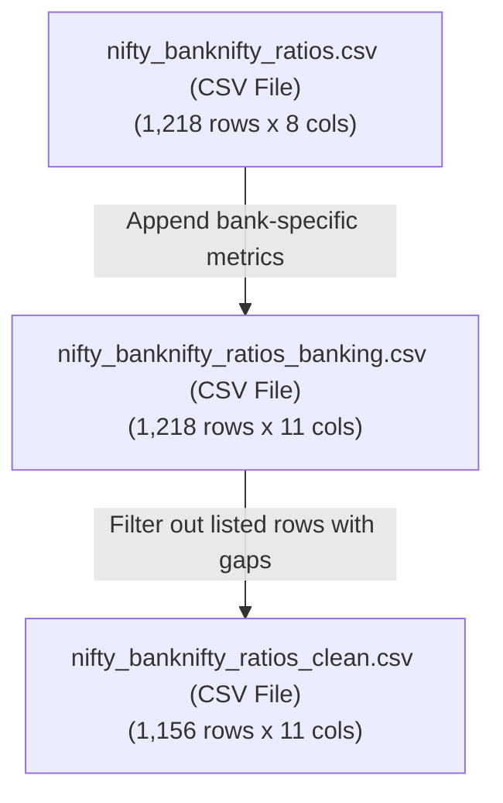

# Quick Overview

- nifty_banknifty_ratios.csv = Raw data without cleaning for quick overview 

- nifty_banknifty_ratios_banking.csv = Banking-specific columns augmented to nifty_banknifty_ratios.csv

- nifty_banknifty_ratios_clean.csv = Cleaned dataset with missing values removed

# Detailed description

# Analysis and Representation of Ratio Output Files

This document provides a verified description of the three output files. 

After cross-checking the actual file schemas, sizes, and row contents using programmatic inspection, we identified that the file naming conventions and their content mapping are slightly different from the initial assumptions. Below is the verified mapping and a detailed description of how each file represents the data.

---

## 1. Quick Summary of File Attributes

| File Name | File Type | Row Count | Column Count | Banking Columns? (`NIM`, `NPA_Ratio`, `CAR`) | Gaps & Cleaning Status |
| :--- | :--- | :---: | :---: | :---: | :--- |
| nifty_banknifty_ratios.csv | CSV File | 1,218 | 8 | **No** | Base dataset (unfiltered rows) containing standard corporate ratios. |
| nifty_banknifty_ratios_banking.csv | CSV File | 1,218 | 11 | **Yes** | Raw augmented dataset with bank-specific ratios but retains all historical gaps. |
| nifty_banknifty_ratios_clean.csv | CSV File | 1,156 | 11 | **Yes** | Filtered dataset with listed-year gaps removed (62 rows dropped). |

---

## 2. Pipeline Data Flow

The relationship and generation flow between these files are represented below:

---

## 3. Detailed File Descriptions

### A. nifty_banknifty_ratios.csv (CSV File)
*   **Purpose**: Represents the core base financial dataset containing standard corporate ratios collected for 58 companies across 21 years (2005 to 2025).
*   **Schema (8 Columns)**: `Year`, `Company`, `Sector`, `PE`, `ROE`, `ROCE`, `Current_Ratio`, `Debt_Equity`
*   **Data Representation**:
    *   Covers both banking and non-banking companies.
    *   For the 14 banking companies (categorized under the `Regional Banks` sector), standard corporate metrics like `ROCE` and `Current_Ratio` are naturally left blank (`NaN` or empty) because they are not meaningful or reported on traditional banking balance sheets.
    *   This file does **not** contain any banking-specific indicators.
    *   Contains all 1,218 historical rows (no rows are filtered out due to missing data).

### B. nifty_banknifty_ratios_banking.csv (CSV File)
*   **Purpose**: Represents the raw augmented financial dataset incorporating both corporate and banking-specific ratios.
*   **Schema (11 Columns)**: Same as above, plus `NIM` (Net Interest Margin), `NPA_Ratio` (Net Non-Performing Assets Ratio), and `CAR` (Capital Adequacy Ratio).
*   **Data Representation**:
    *   For the 14 banking companies, the 3 newly added banking-specific metrics (`NIM`, `NPA_Ratio`, `CAR`) are populated for years in which the bank had active exchange listings (verified by the presence of `PE` ratio values).
    *   For all non-banking companies, these 3 banking columns are left entirely empty (`NaN`).
    *   **Gaps**: This file retains all historical records and has **not** been cleaned. It contains data gaps (e.g., missing metrics in early listed years for certain banks, or missing insurance-specific metrics for companies like `HDFCLIFE`).

### C. nifty_banknifty_ratios_clean.csv (CSV File)
*   **Purpose**: Represents the cleaned, high-quality subset of the banking-augmented dataset, suitable for modeling or statistics where data completeness in active listed years is required.
*   **Schema (11 Columns)**: `Year`, `Company`, `Sector`, `PE`, `ROE`, `ROCE`, `Current_Ratio`, `Debt_Equity`, `NIM`, `NPA_Ratio`, `CAR`
*   **Data Representation and Filtering Logic**:
    *   This file removes rows representing listed years (where `PE` is not null) that contain missing values (gaps) in their sector-applicable columns.
    *   The filtering rules applied are:
        *   **For Banks (`Regional Banks`)**: Rows must have all of `PE`, `ROE`, `Debt_Equity`, `NIM`, `NPA_Ratio`, and `CAR` populated.
        *   **For Non-Banks**: Rows must have all of `PE`, `ROE`, `ROCE`, `Current_Ratio`, and `Debt_Equity` populated.
        *   **Pre-listing Rows (where `PE` is empty)**: These rows are kept as-is to preserve historical timeline continuity (e.g., pre-IPO years).
    *   **Dropped Records**: Due to these rules, **62 rows** containing gaps were filtered out (reducing the row count from 1,218 to 1,156). Examples of dropped rows include early listed years (2006–2011) for banks (such as `AXISBANK`, `SBIN`, `HDFCBANK`, `ICICIBANK`) due to missing traditional debt/equity figures, and `HDFCLIFE` (2017–2025) due to missing corporate ratio coverages.
    *   As a result, all remaining listed rows (1,010 in total) have 100% complete data for their respective sector-relevant metrics.
